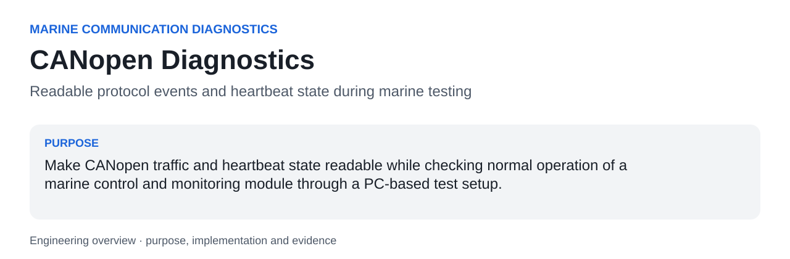
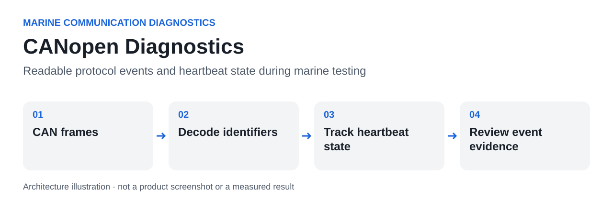

<a id="readme-top"></a>



# CANopen Diagnostics

**Readable protocol events and heartbeat state during marine testing.**

Make CANopen traffic and heartbeat state readable while checking normal operation of a marine control and monitoring module through a PC-based test setup.

| At a glance | |
|---|---|
| Context | Marine Communication Diagnostics |
| Current evidence | Source-level decoder checks and author-confirmed marine test context |
| Stack | Python, JavaScript, C#, CANopen, Saleae HLA, CanKing WIT host interfaces, Kvaser canlib, pyserial, tkinter |
| Author | [hupositoc](https://github.com/hupositoc) |

[Case study](docs/case-study.md) · [Architecture](docs/architecture.md) · [Validation](docs/validation.md) · [Design rationale](docs/design-rationale.md)

## Table of Contents

- [About The Project](#about-the-project)
- [Getting Started](#getting-started)
- [Usage](#usage)
- [Roadmap](#roadmap)
- [Contributing](#contributing)
- [License](#license)
- [Contact](#contact)
- [Acknowledgments](#acknowledgments)

## About The Project

### Why I built it

The author associates these communication checks with Type Approval testing under plans referring to DNV-CG-0339 and LR-TS-01. No product identity, laboratory identity, bus capture or approval certificate is included.

A CAN identifier and a byte string are insufficient for quick interpretation during a test. The engineer needs to distinguish boot-up, operational and stopped states, identify SDO requests or aborts, and notice when an expected heartbeat is no longer arriving.

### What I implemented

Provide a Saleae HLA that maps common CANopen identifiers and fields to readable events, plus CanKing host processors that track heartbeat counts, timeout state and recovery. Keep decoding and liveness monitoring separate because a valid message and timely communication are different questions.

A third tool, the SDO + SSI logger, actively asks the module instead of only listening: it reads the CiA 301 identity objects once, polls communication objects (error register, heartbeat and guard settings) during a run, and writes SSI encoder bytes from a serial bridge into the same timestamped session log.

### What this made possible

- Read NMT, SYNC, emergency, PDO, SDO and heartbeat events without repeatedly looking up identifier ranges.
- Track heartbeat arrival and timeout transitions during a performance log.
- Relate communication-state observations to periodic status-signal measurements from the wider test setup.
- Keep SDO answers, SDO aborts and SSI encoder data in one session log, so a missing CAN response and a silent encoder can be told apart.

### What happened in practice

The code provides readable protocol interpretation and state-tracking support for the author’s test workflow. It does not implement the complete CANopen specification or prove that a device passed protocol conformance or Type Approval.

### Built With

Python, JavaScript, C#, CANopen, Saleae HLA, CanKing WIT host interfaces, Kvaser canlib, pyserial, tkinter. Dependencies provide integration capabilities; the source links below identify the project-specific behavior.

### Engineering decisions

### Decode and monitor separately

A heartbeat decoder labels a received message. A monitor also needs a clock and persistent state to detect the absence of a message.

### Keep unknown events visible

Unrecognized frames retain their CAN identifier and bytes. Unknown does not become a false operational state.

### Document implementation differences

JS and C# defaults differ. They are related implementations, not a verified equivalence pair.

### Code to inspect

| Source entry point | Responsibility |
|---|---|
| [`decode_canopen`](saleae-hla/HighLevelAnalyzer.py#L52) | Routes identifier ranges to protocol-specific decoders. |
| [`decode_heartbeat`](saleae-hla/HighLevelAnalyzer.py#L91) | Maps boot-up, stopped, operational and pre-operational states. |
| [`decode_sdo`](saleae-hla/HighLevelAnalyzer.py#L85) | Extracts index, subindex, payload and abort codes. |
| [`timeoutMs`](heartbeat-js/basic.js#L4) | JS host state machine; default timeout 6000 ms. |
| [`TimeoutMs`](heartbeat-csharp/basic.cs#L13) | C# host state machine; default timeout 3000 ms. |
| [`world`](heartbeat-js/dataprocessor.wit#L6) | Describes the host/component interface. |
| [`sdo_upload_request`](sdo-ssi-logger/sdo_ssi_logger.py) | Builds the expedited SDO upload request (COB-ID 0x600 + node). |
| [`parse_sdo_response`](sdo-ssi-logger/sdo_ssi_logger.py) | Separates data replies from abort codes and names the CiA 301 abort reason. |
| [`SdoSsiLogger`](sdo-ssi-logger/sdo_ssi_logger.py) | tkinter GUI; CAN and SSI workers report to the UI through a queue. |

### AI-assisted engineering

I use AI development tools to turn concrete needs into working software. My engineering responsibilities include defining the problem, interpreting the operating constraints, reviewing behavior, investigating failures and checking results. AI assistance is a development method; it is not evidence that a feature works. File-by-file AI authorship or a specific assistant/model is not claimed without the corresponding development record.

## Getting Started

### Prerequisites

Python for decoder tests; Logic 2 for the HLA; a Kvaser interface with canlib and pyserial for the SDO + SSI logger; the relevant CanKing host and WASI toolchain for JS/C# processors.

### Installation

```text
git clone https://github.com/hupositoc/canopen-diagnostics.git
cd canopen-diagnostics
```

Then follow the project-specific path:

```text
python -m unittest discover -s tests -v
```

The commands describe the intended setup. See the validation record for which parts were actually executed in the current environment.

## Usage



**Text equivalent:** CAN frames → Decode identifiers → Track heartbeat state → Review event evidence.

Start by defining the intended input and expected behavior. Save the configuration with the experiment or test session so that an output can be interpreted later. Review exceptions and raw evidence before treating a summary as a final conclusion.

Decoder fixture tests exercise actual HLA parsing through a minimal frame-interface adapter. They do not simulate hardware sampling, a complete CANopen stack or the CanKing runtime.

### Boundaries and known limitations

- The HLA is a focused decoder and does not cover every CANopen service or malformed-frame condition.
- CanKing API/WASI integration and real-bus timing have not been revalidated here.
- Timeout and node-ID defaults are configuration examples, not certification requirements.
- The SDO + SSI logger handles expedited uploads only (no segmented transfer) and has not been rerun on hardware since publication.

Read the [case study](docs/case-study.md) for the purpose and enabled workflow, and [architecture](docs/architecture.md) for the source-level explanation. The [validation document](docs/validation.md) separates verified checks, author-reported use and pending integration work.

## Roadmap

- [ ] Add timestamped heartbeat integration fixtures.
- [ ] Make node ID and timeout explicit deployment configuration.
- [ ] Compare JS and C# results on the same event stream before claiming parity.

These are planned tasks, not completed capabilities.

## Contributing

Use an issue to describe a reproducible problem, expected behavior, actual behavior and the environment. For a change, keep the scope focused and attach the relevant test or recording. Do not submit private customer data, identifying test captures, credentials or confidential certification documents.

## License

Existing file-level notices and third-party licenses remain in force. A repository-wide open-source license has not been selected for all archived material. Public visibility does not grant rights beyond those existing terms. Documentation structure attribution does not relicense the software.

## Contact

[hupositoc on GitHub](https://github.com/hupositoc) · [Project issues](https://github.com/hupositoc/canopen-diagnostics/issues)

## Acknowledgments

The top-level section order follows [Best-README-Template](https://github.com/othneildrew/Best-README-Template), reviewed under its [Unlicense](https://github.com/othneildrew/Best-README-Template/blob/main/LICENSE.txt). All project narratives are written for this implementation. Visual guidance is attributed in [design rationale](docs/design-rationale.md). The broader 50-repository documentation review informs the reading order, source links and evidence presentation; it does not imply endorsement by those projects.


[Engineering decision record](docs/engineering-decisions.md) · [Review of 50 reference repositories](docs/reference-review-50.md)
