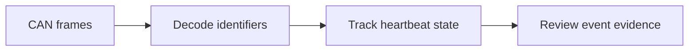

# Architecture and source walkthrough

## System boundary

Provide a Saleae HLA that maps common CANopen identifiers and fields to readable events, plus CanKing host processors that track heartbeat counts, timeout state and recovery. Keep decoding and liveness monitoring separate because a valid message and timely communication are different questions.

This is a source-derived conceptual diagram, not a captured execution trace. The text equivalent is CAN frames → Decode identifiers → Track heartbeat state → Review event evidence.

## Source responsibilities

| Source entry point | Responsibility |
|---|---|
| [`decode_canopen`](../saleae-hla/HighLevelAnalyzer.py#L52) | Routes identifier ranges to protocol-specific decoders. |
| [`decode_heartbeat`](../saleae-hla/HighLevelAnalyzer.py#L91) | Maps boot-up, stopped, operational and pre-operational states. |
| [`decode_sdo`](../saleae-hla/HighLevelAnalyzer.py#L85) | Extracts index, subindex, payload and abort codes. |
| [`timeoutMs`](../heartbeat-js/basic.js#L4) | JS host state machine; default timeout 6000 ms. |
| [`TimeoutMs`](../heartbeat-csharp/basic.cs#L13) | C# host state machine; default timeout 3000 ms. |
| [`world`](../heartbeat-js/dataprocessor.wit#L6) | Describes the host/component interface. |

## Design decisions

### Decode and monitor separately

A heartbeat decoder labels a received message. A monitor also needs a clock and persistent state to detect the absence of a message.

### Keep unknown events visible

Unrecognized frames retain their CAN identifier and bytes. Unknown does not become a false operational state.

### Document implementation differences

JS and C# defaults differ. They are related implementations, not a verified equivalence pair.

## Input/output contract to preserve

The input configuration must be recoverable alongside the output. Defaults should be treated as this implementation’s starting values, not an external standard. An integration test must check the real host/runtime because an isolated function test cannot establish timing, UI, hardware or external-service behavior.

When modifying the code, identify which responsibility changes: input acquisition, interpretation, persistent state or output presentation. Keep the public behavior and its test evidence together. Avoid silently converting a missing input or failed integration into a successful result.

## Known boundaries

- The HLA is a focused decoder and does not cover every CANopen service or malformed-frame condition.
- CanKing API/WASI integration and real-bus timing have not been revalidated here.
- Timeout and node-ID defaults are configuration examples, not certification requirements.
